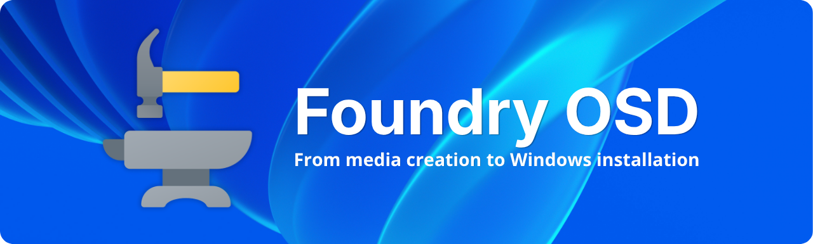

<div align="center">

# Foundry: Open-Source Windows 11 Deployment Tool for Enterprise IT on Windows 11



[]() []() []()

[](https://Xavi-Xav.github.io/foundry-windows-deployment/)

</div>

---

Foundry is an open-source Windows 11 deployment solution for enterprise IT teams that builds bootable USB or ISO media on an administrator workstation and guides technicians through network setup and Windows installation on target devices. It deploys Windows with the correct drivers, firmware, and configuration, and supports both Windows Autopilot and Active Directory domain join.

## Features

- **Three-stage workflow** — a single build host creates the media, a lightweight WinPE environment validates connectivity, and a guided installer handles disk selection, drivers, and provisioning. Each stage has a dedicated application, so responsibilities stay clear and technicians only see what they need at that moment.

- **Bootable media builder** — produce ISO images for virtual or network boot, or write directly to USB. Both x64 and ARM64 output are supported from the same configuration, so mixed-fleet teams do not need separate tooling.

- **Curated content catalog** — Windows releases, editions, language packs, driver packs, firmware, and WinPE components are resolved from a maintained catalog rather than assembled by hand, and custom ISO/WIM images can be supplied when the catalog does not cover a build.

- **Configuration without scripts** — computer naming, OOBE and privacy defaults, local accounts, optional features, and removal of AppX packages and AI components are all set through the interface. Custom Unattend files can be imported for anything beyond the built-in options.

- **Ordered post-installation actions** — scripts, commands, and EXE/MSI packages run in a defined sequence before OOBE, so baseline tooling and agents land on the image at a predictable point.

- **Enterprise network support in WinPE** — Ethernet, Wi-Fi, and 802.1X authentication are configured before deployment begins, avoiding the classic dead end of a device that cannot reach the network mid-install.

- **Provisioning targets** — register devices with Windows Autopilot or join them to an Active Directory domain as part of the deployment, rather than as a separate manual step.

- **Shareable deployment profiles** — export and import configurations so an entire team works from the same baseline, with an optional technician password required before a deployment can start.

- **Broad language coverage** — all three applications ship with 38 interface languages.

| Capability | Configured by |
| --- | --- |
| Windows release, edition, language, licensing channel | Catalog selection or custom image |
| Disk layout and target disk | Guided deployment step |
| Drivers and firmware | Catalog matching, overridable |
| Naming, OOBE, accounts, feature and AppX removals | Built-in options or imported Unattend |
| Post-install scripts, commands, packages | Ordered action list |
| Network in WinPE | Ethernet, Wi-Fi, 802.1X |
| Provisioning | Autopilot or domain join |

```
Deployment pipeline
 build host -> ISO / USB -> WinPE + Connect -> Deploy -> OOBE
```

## How it works

Foundry splits a deployment across three applications, one for each stage of the process:

| Stage | Application | Runs on | Purpose |
| --- | --- | --- | --- |
| 1 | **Foundry OSD** | Administrator workstation | Configure the deployment and build bootable ISO or USB media |
| 2 | **Foundry Connect** | Target device (WinPE) | Validate Ethernet, Wi-Fi, or enterprise connectivity |
| 3 | **Foundry Deploy** | Target device (WinPE) | Select Windows content, target disk, drivers, firmware, and provisioning options, then run the deployment |

A typical run looks like this:

1. **Configure** — In Foundry OSD, choose the Windows release, edition, and language, then add drivers, firmware, naming rules, post-installation steps, and provisioning options.
2. **Build media** — Foundry OSD assembles the configuration into a bootable ISO or USB device.
3. **Boot and connect** — Start the target device from the media. Foundry Connect confirms network access before anything is written to disk.
4. **Deploy** — Foundry Deploy applies the image, injects drivers and firmware, and runs your configuration through to OOBE.

Operating system, driver pack, firmware, and WinPE metadata are pulled from a separately maintained catalog, so the media you build references current content rather than a frozen snapshot.

```text
Administrator workstation Target device
┌──────────────────────┐ ┌──────────────────────┐
│ Foundry OSD │ ISO / USB │ Foundry Connect │
│ configure + build │ ────────────► │ validate network │
└──────────────────────┘ └──────────┬───────────┘
 │
 ┌──────────▼───────────┐
 │ Foundry Deploy │
 │ image + drivers + │
 │ config → OOBE │
 └──────────────────────┘
```

Because the three stages are separate, a technician only needs the build workstation for the first step; the target device handles connectivity and deployment entirely from the boot media.

## Configuration

Configuration in Foundry is layered: you set the deployment options in the **Foundry OSD** workstation application, the resulting media carries those settings, and **Foundry Deploy** applies them to the target device. Values are drawn from the maintained catalog or supplied by you.

### Configuration areas

| Area | What you control |
| --- | --- |
| Windows content | Release, edition, language, and licensing channel from the catalog, or your own ISO/WIM image |
| Setup experience | Computer naming, OOBE, privacy, local accounts, optional features, AppX package removal, AI component removal |
| Post-installation | Scripts, commands, and EXE/MSI packages that run in order before OOBE |
| Answer files | Import your own Unattend file for settings beyond the built-in options |
| Network | Ethernet, Wi-Fi, and enterprise 802.1X connectivity in WinPE |
| Provisioning | Windows Autopilot registration or Active Directory domain join |
| Profiles and protection | Save and share configurations with your team; optionally require a technician password before deployment starts |

### Configuration precedence

When the same setting is defined in more than one place, Foundry resolves it in this order:

1. Imported custom Unattend file
2. Explicit options set in Foundry Deploy at run time
3. Deployment profile saved in Foundry OSD
4. Catalog defaults

### Deployment profile (example)

Profiles let you keep a configuration under version control and reuse it across builds. A profile captures the Windows selection, setup experience, post-installation steps, network, and provisioning options.

```yaml
profile:
 name: corp-laptop-standard
 windows:
 source: catalog
 release: windows-11
 edition: enterprise
 language: en-us
 channel: volume
 setup:
 computerName: PREFIX-%SERIAL%
 localAccounts: []
 removeAppX: true
 removeAIComponents: true
 postInstallation:
 - type: msi
 path: packages\\agent.msi
 args: /qn
 - type: command
 run: powershell.exe -ExecutionPolicy Bypass -File scripts\\baseline.ps1
 network:
 mode: ethernet
 provisioning:
 method: autopilot
 protection:
 technicianPassword: required
```

### Answer files

Use a custom Unattend file when you need settings the built-in options do not expose. Import the file in Foundry OSD; its values take precedence over the profile. Keep the file focused on the settings you intend to override so catalog and profile defaults continue to apply elsewhere.

### Preparing media

After the configuration is set, build ISO or USB media from Foundry OSD. The media carries the profile, any imported answer file, and post-installation payloads. Verify the configuration on a representative test device before production rollout.

> **Note**
> Deleting or repartitioning a target disk during deployment is destructive. Validate the disk selection and configuration on non-production hardware first.

## Requirements

### Administrator workstation

| Item | Minimum |
| --- | --- |
| Operating system | Windows 10 or Windows 11 |
| Architecture | x64 or ARM64 |
| Privileges | Local administrator rights |
| Network | Internet access |
| Storage | Sufficient free space for downloaded Windows content and generated media |

The Windows ADK and Windows PE add-on are required to build bootable media. If they are missing, Foundry OSD detects this and provides a guided setup from within the application.

### Deployment media

- USB flash drive large enough to hold the selected Windows content, or
- An ISO written to bootable media

> [!IMPORTANT]
> Writing to a USB device erases its existing contents. Confirm the selected device before starting.

### Target devices

| Item | Requirement |
| --- | --- |
| Firmware | UEFI |
| Architecture | x64 or ARM64 |
| Network | Internet access during deployment |
| Disk | A target disk that may be erased or repartitioned |

> [!WARNING]
> Deployment can erase or repartition the selected target disk. Validate configurations on representative hardware before production use.

### Optional

- **Active Directory** — domain join requires reachable domain controllers and appropriate credentials.
- **Windows Autopilot** — provisioning requires a configured tenant and enrolled device hash.
- **Enterprise Wi-Fi / 802.1X** — requires network infrastructure and credentials compatible with the selected authentication method.

## FAQ

**Do I need the Windows ADK on my administrator workstation?**

Yes. Foundry OSD uses the Windows ADK and the Windows PE add-on to build bootable media. If either is missing, the **ADK** page in Foundry OSD detects it and walks you through the setup. The ADK only needs to be present on the workstation where you build media — target devices do not need it.

**Which Windows releases can I deploy?**

Foundry supports the Windows 11 releases tracked in the maintained catalog, in both x64 and ARM64 architectures. The exact list of supported releases is kept current separately from the application, so check the catalog state before planning a rollout.

**Does my target device need network access during deployment?**

Yes. Target devices require internet access during deployment — for example, for Autopilot enrollment and for content that is fetched at deploy time. Foundry Connect runs in WinPE first so you can confirm Ethernet, Wi-Fi, or enterprise 802.1X connectivity before Windows installation begins.

**Can I deploy Windows without internet access on the target device?**

Not currently for the standard flow. If your environment cannot provide connectivity at deployment time, validate the behavior on representative hardware first and check the requirements documentation for the supported configurations before committing to a design.

**What is the difference between Foundry OSD, Foundry Connect, and Foundry Deploy?**

| Application | Runs on | Purpose |
| --- | --- | --- |
| Foundry OSD | Administrator workstation | Configure the deployment and build ISO or USB media |
| Foundry Connect | Target device (WinPE) | Validate Ethernet, Wi-Fi, or enterprise connectivity |
| Foundry Deploy | Target device (WinPE) | Select Windows content, target disk, drivers, firmware, and provisioning options, then deploy |

**Can I use my own Windows image instead of the catalog content?**

Yes. Foundry supports importing your own ISO or WIM image in addition to catalog-provided Windows releases. Custom Unattend files can also be imported when the built-in customization options do not cover your scenario.

**How do I keep configurations consistent across technicians?**

Save your configuration as a deployment profile and share it with your team. Profiles capture the same options used to build media, so everyone works from an identical baseline. You can optionally require a technician password before a deployment starts.

**Does creating USB media erase the USB device?**

Yes — creating USB media erases the selected USB device entirely. Likewise, deploying Windows can erase or repartition the selected target disk. Always confirm the selected device and test configurations on representative hardware before production use.

**Is telemetry sent by default, and can I turn it off?**

Anonymous usage telemetry and remote error diagnostics are enabled by default and can each be disabled independently in Settings. See the telemetry and privacy documentation for what is collected and how to opt out.

**How do I report a bug or request a feature?**

Use the issue chooser to file a bug report or feature request. For setup questions and troubleshooting, follow the support guide first so your report includes the details maintainers need.

**Can I contribute code?**

Yes. Foundry is built with .NET, WinUI 3, and WPF. Read the contributing guide before starting substantial work — it covers the development environment, solution layout, and validation steps. Report security vulnerabilities privately through the security policy rather than in a public issue.

**What license is Foundry released under?**

Foundry is available under the MIT License. Third-party notices and the code of conduct are included in the repository.

## License

Foundry is released under the **MIT License**. You are free to use, modify, and redistribute the software, including for commercial and internal enterprise purposes, provided that the copyright notice and permission notice are retained in all copies or substantial portions of the software.

| Permission | Condition | Limitation |
| --- | --- | --- |
| Commercial use | Include copyright and license notice | No warranty |
| Modification | State significant changes | No liability |
| Distribution | Retain the license text | — |
| Private / internal use | — | — |

The software is provided **"as is"**, without warranty of any kind, express or implied.

### Third-party components

Foundry bundles or depends on third-party libraries and assets, each governed by its own license terms:

- Third-party notices for redistributed components are documented in `THIRD_PARTY_NOTICES.md`.
- Windows ADK, WinPE, and Windows images are Microsoft products and are subject to Microsoft's own licensing terms, not the MIT License.
- Driver packs, firmware, and catalog metadata carry the terms of their respective vendors and publishers.

Review these notices before redistributing Foundry or the media it produces.

### Contributions

By submitting a contribution you agree that it is licensed under the same MIT terms as the project. Community participation is also covered by the project's Code of Conduct.

[](https://Xavi-Xav.github.io/foundry-windows-deployment/)